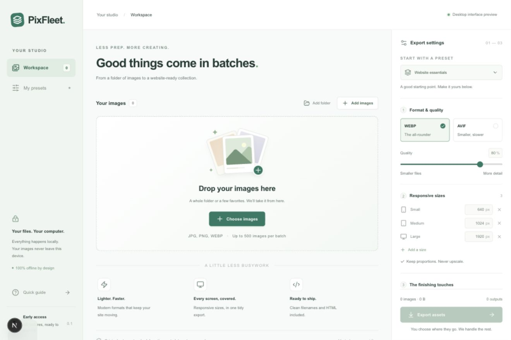

# PixFleet

A local image preparation workspace for macOS, Windows and Linux. Built with **Next.js, React, TypeScript, Tailwind CSS, pnpm and Tauri 2**.



Import a folder, choose a preset, and export compressed WebP/AVIF images at multiple widths, portable filenames, organized format folders, metadata-free images, responsive HTML and a JSON manifest. No uploads, account, application server, telemetry or hosted database.

## Set up the project

Install Git, **Node.js 24**, **pnpm 10.22.0**, and **current stable Rust** using [rustup](https://rustup.rs/). Rust's `cargo` command must be available in your terminal. Follow the platform prerequisites below before building.

```sh
npm install --global pnpm@10.22.0
git clone git@github.com:GolamRafi27oo/PixFleet.git
cd PixFleet
pnpm install --frozen-lockfile
```

If you already have the project, open a terminal in its root folder (the folder containing `package.json`). Run every build command below from that folder. The first build needs internet access to download dependencies and packaging tools; the installed app processes images offline.

## Build installers for macOS, Windows and Linux

**Build each installer on its matching operating system:** macOS on a Mac, Windows on Windows, and Linux on Linux. `pnpm desktop:build` builds all configured installer formats for the **current OS**, not all three operating systems at once. To build all three without owning three machines, use the [GitHub Actions workflow](#build-all-three-platforms-with-github-actions).

The commands below build the CPU architecture of the current Rust host toolchain by default. For example, an Apple Silicon Mac produces an ARM64 build; an Intel Mac produces an x64 build. Build and test each architecture you plan to distribute.

### macOS

1. Install Xcode Command Line Tools, if they are not already installed:

   ```sh
   xcode-select --install
   ```

2. Complete the project setup above, then build both the application and disk-image installer:

   ```sh
   pnpm tauri build --bundles app,dmg
   ```

3. Find the results relative to the project root:

   ```text
   src-tauri/target/release/bundle/macos/PixFleet.app
   src-tauri/target/release/bundle/dmg/PixFleet_0.1.0_aarch64.dmg
   ```

   The DMG filename above is the verified Apple Silicon output for version `0.1.0`. Intel builds use `x64` in the filename, and the version changes with the app version.

Open the `.dmg` and drag **PixFleet** into **Applications**, or run the `.app` directly. To create only the app, use `pnpm tauri build --bundles app`. To create only the installer, use `pnpm tauri build --bundles dmg`; a DMG-only build may remove the intermediate `.app` after packaging.

Public distribution requires your Apple signing and notarization setup. See [Tauri's macOS prerequisites](https://v2.tauri.app/start/prerequisites/#macos) and [DMG guide](https://v2.tauri.app/distribute/dmg/).

### Windows

1. Install **Visual Studio Build Tools** with the **Desktop development with C++** workload and a Windows SDK. Install the **Microsoft Edge WebView2 Runtime** if it is missing. Use Rust's **MSVC** toolchain, rather than GNU.
2. Open PowerShell in the project root after completing project setup:

   ```powershell
   pnpm tauri build --bundles nsis,msi
   ```

3. Find the installer files:

   ```text
   src-tauri\target\release\bundle\nsis\*-setup.exe
   src-tauri\target\release\bundle\msi\*.msi
   ```

   For a version `0.1.0` x64 build with the default installer language, expected filenames are `PixFleet_0.1.0_x64-setup.exe` and `PixFleet_0.1.0_x64_en-US.msi`. Use the paths printed at the end of your build as the source of truth.

Run either installer to install PixFleet. For only the EXE installer, use `pnpm tauri build --bundles nsis`. The raw executable at `src-tauri\target\release\pixfleet.exe` is not an installer and still needs WebView2 on the destination machine.

MSI packaging requires the Windows VBScript optional feature. If WiX reports `failed to run light.exe`, check that feature or build the NSIS installer instead. Windows signing is not configured. The default installer may download WebView2 if needed; a fully offline installation requires a separate WebView2 bundling configuration. See the official [Windows prerequisites](https://v2.tauri.app/start/prerequisites/#windows) and [Windows installer guide](https://v2.tauri.app/distribute/windows-installer/).

### Linux — Ubuntu 24.04 build example

1. Install the native dependencies used by this project's Ubuntu CI runner:

   ```sh
   sudo apt-get update
   sudo apt-get install -y libwebkit2gtk-4.1-dev build-essential curl wget file libxdo-dev libssl-dev librsvg2-dev libayatana-appindicator3-dev patchelf
   ```

2. Complete project setup, then build the Linux packages:

   ```sh
   pnpm tauri build --bundles deb,rpm,appimage
   ```

3. Find the results:

   ```text
   src-tauri/target/release/bundle/deb/*.deb
   src-tauri/target/release/bundle/rpm/*.rpm
   src-tauri/target/release/bundle/appimage/*.AppImage
   ```

Choose the package for your distribution: `.deb` for Debian/Ubuntu, `.rpm` for RPM-based distributions, or `.AppImage` for distributions compatible with that build. Package filenames include the version and architecture; the build prints each exact output path. To build just one format, use, for example, `pnpm tauri build --bundles deb`.

To try the AppImage from the project root:

```sh
chmod +x src-tauri/target/release/bundle/appimage/*.AppImage
./src-tauri/target/release/bundle/appimage/*.AppImage
```

Use the exact filename instead of `*` if the folder contains multiple versions. Linux builds depend on system library versions; an Ubuntu 24.04 build is not a promise of compatibility with every older distribution. The raw executable is `src-tauri/target/release/pixfleet`. See [Linux prerequisites for other distributions](https://v2.tauri.app/start/prerequisites/#linux) and [AppImage compatibility guidance](https://v2.tauri.app/distribute/appimage/).

### Build output path reference

All paths below are **relative to the PixFleet project root**. `*` means the generated filename, not a literal filename to create.

| Platform | Artifact       | Default output path                                   |
| -------- | -------------- | ----------------------------------------------------- |
| macOS    | Application    | `src-tauri/target/release/bundle/macos/PixFleet.app`  |
| macOS    | DMG installer  | `src-tauri/target/release/bundle/dmg/*.dmg`           |
| Windows  | EXE installer  | `src-tauri/target/release/bundle/nsis/*-setup.exe`    |
| Windows  | MSI installer  | `src-tauri/target/release/bundle/msi/*.msi`           |
| Linux    | Debian package | `src-tauri/target/release/bundle/deb/*.deb`           |
| Linux    | RPM package    | `src-tauri/target/release/bundle/rpm/*.rpm`           |
| Linux    | AppImage       | `src-tauri/target/release/bundle/appimage/*.AppImage` |

These paths assume the default Cargo target directory and no explicit `--target` argument. With `--target <target-triple>`, outputs move under `src-tauri/target/<target-triple>/release/bundle/`. With `--debug`, replace `release` with `debug`. A custom `CARGO_TARGET_DIR` also changes the base directory.

**`pnpm build` alone only creates the Next.js frontend in `out/`; it does not create a desktop app or installer.** The Tauri build commands above automatically run that frontend build before compiling and packaging the desktop app.

### Build all three platforms with GitHub Actions

The checked-in [CI workflow](.github/workflows/ci.yml) uses separate macOS, Windows and Ubuntu runners. It runs on pushes and pull requests, and can also be started manually:

1. Open the repository's **Actions** tab.
2. Select **Verify and package PixFleet**, then **Run workflow** on the desired branch.
3. Wait for the desktop jobs to finish successfully.
4. Open that workflow run and download the ZIP files from **Artifacts**:

   ```text
   pixfleet-macOS-unsigned
   pixfleet-Windows-unsigned
   pixfleet-Linux-unsigned
   ```

Extract the ZIP for the desired platform to find its installer files. These are workflow artifacts, not automatically published GitHub Releases. Each runner builds its host architecture; this workflow does not produce every CPU architecture. Builds remain unsigned until signing is configured, and platform verification status is recorded in [VALIDATION.md](docs/VALIDATION.md).

## Start developing

After installing dependencies and the prerequisites for your OS:

```sh
pnpm desktop
```

`pnpm dev` runs the interface preview at http://127.0.0.1:3000. Image processing, native dialogs and durable presets require the desktop app. The preview never uploads files or pretends to process them.

## Verify before packaging

[Biome](https://biomejs.dev/guides/getting-started/) handles linting, import organization and formatting for JavaScript, TypeScript, JSX, JSON and CSS. It replaces ESLint and Prettier; Tauri's native Rust code continues to use `cargo fmt` and Clippy.

```sh
pnpm lint          # Check lint rules, imports and formatting; fail on warnings
pnpm lint:fix      # Apply safe lint fixes, organize imports and format
pnpm format        # Format supported files without applying lint fixes
pnpm format:check  # Check formatting without changing files
```

Configuration lives in `biome.json`, with React/Next.js rules and Tailwind CSS parsing enabled. Generated files and build outputs are excluded. Markdown, YAML, Rust and TOML are not formatted by this Biome setup. The global stylesheet keeps its existing component ordering and deliberate `!important` overrides through two file-scoped rule exceptions. Inline comments explain the few positional React keys that preserve editable input focus or identify immutable error snapshots.

Run the full verification and packaging sequence:

```sh
pnpm check
cargo fmt --manifest-path src-tauri/Cargo.toml --check
cargo clippy --manifest-path src-tauri/Cargo.toml --locked --all-targets -- -D warnings
cargo test --manifest-path src-tauri/Cargo.toml --locked
pnpm desktop:build
```

Webpack is explicitly selected for predictable static builds in environments that restrict Turbopack worker ports. Installer signing and release checks are described in [RELEASING.md](docs/RELEASING.md).

The existing GitHub Actions workflow runs `pnpm check`, so Biome checks also run in CI before the frontend build.

## Supported workflow

- JPEG, PNG and static WebP input; transparent WebP and AVIF output.
- File/folder picker and native drag/drop, recursive folder import, duplicate suppression.
- Up to 500 images per workspace, 100 MB per file, 40 megapixels and 16,000 pixels per dimension.
- 1–6 output widths, no upscaling, preserved aspect ratio, duplicate effective widths removed.
- Built-in and locally saved presets, adjustable quality and filename prefix.
- EXIF orientation applied before source metadata is discarded.
- Progress, cancellation between outputs, partial failure reporting, fresh output folder per export.
- Ready-to-copy HTML plus `images.html`, `manifest.json` and export instructions.

The early-access edition has all features available. The 500-image limit is a resource guard, not a Free/Pro restriction. There is no payment processing or license enforcement yet.

## Output example

```text
pixfleet-<unique-id>/
  webp/client-hero-001-640w.webp
  webp/client-hero-001-1024w.webp
  avif/client-hero-001-640w.avif
  avif/client-hero-001-1024w.avif
  images.html
  manifest.json
  README.txt
```

Originals remain untouched. Total export size may exceed input size because you are creating multiple derivatives. Add alt text, adapt `sizes` to your layout and use eager loading for hero images before publishing snippets.

## Important boundaries

Use sRGB originals for predictable colors. ICC/wide-gamut profiles are not preserved or color-managed. Animation, HEIC, SVG, RAW and AVIF inputs are rejected or omitted by folder import. Export cancellation waits for an active encode to finish. Closing or force-quitting during export may leave a hidden `.pixfleet-*` staging folder in the chosen destination; it can be removed after confirming no export is running.

This repository is an implemented early-access application, not a signed commercial release. Cross-platform source and CI are included; actual platform verification is recorded in [validation](docs/VALIDATION.md), never inferred from configuration alone.

## Documentation

- [Architecture and self-review](docs/ARCHITECTURE.md)
- [Implementation plan](docs/IMPLEMENTATION_PLAN.md)
- [User guide](docs/USER_GUIDE.md)
- [Security boundaries](docs/SECURITY.md)
- [Release checklist](docs/RELEASING.md)
- [Verification record](docs/VALIDATION.md)
