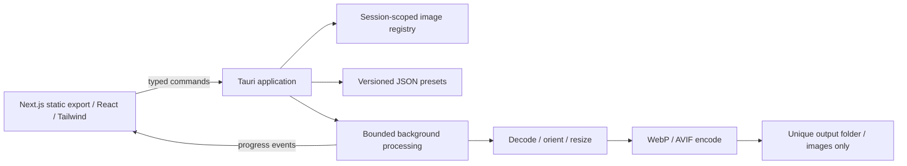

# PixFleet architecture and design review

Status: accepted for implementation • 2 October 2026

## Product boundary

PixFleet prepares local JPEG, PNG, static WebP and HEIC/HEIF files for websites. Users import files or a folder, select a reusable preset, and export responsive WebP, AVIF, PNG, JPEG and/or HEIC variants organized by format. All processing runs on the customer's computer. Originals are never modified. No account, telemetry, database, cloud processing or runtime network dependency is needed.

The first build is an early-access edition with all features available unless the owner elects to enable free limits. Charging customers, signature verification and license delivery are a separate release gate; a cosmetic paywall would not be real licensing.

## Architecture

Next.js is used only as a static frontend, as required by Tauri. No server actions, API routes, image optimization server or remote fonts. Rust owns the processing pipeline so output codecs behave consistently across OS webviews. A browser preview explains the native requirement instead of pretending to process files.

## Decisions and self-review

| Decision                                                | Reason                                                             | Cost / mitigation                                                       |
| ------------------------------------------------------- | ------------------------------------------------------------------ | ----------------------------------------------------------------------- |
| Tauri 2 + Next.js static export                         | Requested stack; small native host, no Node runtime shipped        | Three OS toolchains; CI builds each OS                                  |
| Rust image decoder + libwebp + AVIF encoder + libheif             | Real lossy output, alpha support, offline encoding                 | Native compile time; lock dependencies and test codecs                  |
| Sequential source processing on a blocking worker       | Bounded memory and responsive UI                                   | Slower than unbounded batches; AVIF favors compression over speed       |
| Re-encode decoded pixels, apply EXIF orientation first  | Remove GPS and source metadata without rotating photos incorrectly | ICC/wide-gamut handling is a release limitation; document sRGB inputs   |
| Session identifiers for exports                         | Frontend cannot choose arbitrary export input paths                | Registry persists only for the session                                  |
| Native export folder selection + unique batch directory | Avoid overwrite and path traversal                                 | Each export creates a new folder                                        |
| Cooperative cancellation between outputs                | Safe, predictable cancellation                                     | An active codec operation finishes first; incomplete staging is removed |
| Durable JSON settings in app-data directory             | Offline presets without database hosting                           | Corrupt settings surface an error; never silently overwrite them        |
| Built-in presets with explicit editable widths          | Fast common workflows                                              | No cropping, animation, RAW or SVG support in this release        |

## Data contracts

Imported image: session ID, original name, pixel dimensions, bytes and small JPEG thumbnail. Files are validated by decoding, not extension alone. File count, compressed byte size and decoded pixel dimensions are bounded. Duplicate canonical paths are ignored. Import failures are reported individually.

Preset: stable ID, name, output formats, quality (1–100), unique widths (16–8192), filename prefix. No upscale; duplicate effective widths are removed. Filenames use portable ASCII slugs plus a stable batch index, preventing collisions and Windows reserved names.

Batch: IDs, validated preset, progress events, cancellation flag. Only one active batch. Per-source errors do not discard successful images. The result returned to the UI records image and file counts, total byte counts and failures. Only image files are written to the export folder.

## Security and reliability review

- The packaged CSP blocks remote resources; no general shell or filesystem plugin is exposed.
- Native dialogs and imports are the image-read boundary. Export requests reference registered image IDs, not arbitrary paths. Output filenames are generated, never accepted as paths.
- Decoder resource limits and a pixel ceiling defend against large or malformed images. Symlink directories are not recursively traversed. Folder imports are bounded.
- Decode and encoding run off the UI thread. Work is sequential; cancellation is checked between encoded variants.
- Export staging is a uniquely created private child directory. Success renames it into a final batch directory. Cancellation and fatal failures clean only directories created by this job.
- A failed source removes its own variants; completed exports contain only successful images.
- No auxiliary documents are generated or exported.
- Do not promise every converted image will be smaller; display measured results, including increases.

## Release gates

Automated checks cover type safety, lint, frontend production export, native unit/integration tests, filename safety, no-upscale sizing, orientation, real codec signatures, metadata removal, cancellation, partial failure and output packaging. CI builds macOS, Windows and Linux. Manual testing must cover drag/drop, dialogs, keyboard access, long paths, disk-full errors, cancellation, large real batches and platform installation.

Unsigned local builds are development artifacts. Public distribution requires macOS signing/notarization, Windows signing and clean-machine installer verification. Linux targets need WebKitGTK runtime dependencies. Payment provider choice and offline signed-license design remain commercial release gates.

## References

- https://v2.tauri.app/start/frontend/nextjs/
- https://v2.tauri.app/security/
- https://docs.rs/image/latest/image/
- https://docs.rs/webp/latest/webp/
- https://docs.rs/ravif/latest/ravif/

## Frontend organization (0.2.0)

`src/app/page.tsx` renders the `PixFleetApp` client boundary. Each component lives in its own file under `src/components`; workspace controls, presets, settings, and shared UI have separate folders. Shared buttons, navigation buttons, page headings, and dialogs own their Tailwind styles.

`src/hooks/use-workspace.ts` coordinates native imports, selection, export progress, cancellation, and preset persistence. `src/hooks/use-update-check.ts` handles cancellable release requests; `src/lib/releases.ts` validates responses and compares stable version numbers. Network failures leave the local image workflow available.

Component layout and interaction states use Tailwind utilities. `src/app/globals.css` contains palette variables, element defaults, focus and reduced-motion accessibility rules, and the external support widget's required overrides. New component-specific CSS classes should only be added when utilities cannot express the behavior cleanly.
